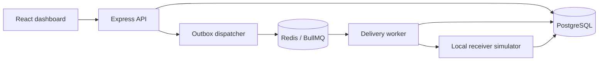

# HookRelay

HookRelay is a local webhook-delivery workbench. It lets you send a repeatable batch of events through a queue, observe delivery attempts, and compare how receiver behavior or worker concurrency changes latency and success rates.

It is designed as a compact backend reliability lab: PostgreSQL is the source of truth, Redis and BullMQ schedule work, a TypeScript worker delivers signed webhooks, and a built-in receiver simulator makes healthy, slow, rate-limited, retrying, and failing behavior reproducible.

## Start the demo

Requirements: Docker Desktop (or Docker Engine) with the Compose plugin.

```sh
git clone https://github.com/danielngira/hookrelay.git
cd hookrelay
docker compose up --build
```

Open **http://localhost:5173**. Compose starts PostgreSQL and Redis, applies the schema and sample destinations, then starts the API, delivery worker, receiver simulator, and dashboard. Stop with `Ctrl+C`. Run `docker compose down -v` to remove the local database and saved runs.

The Compose key and database credentials are demo-only values for a local machine. Do not reuse them for a reachable service. To run outside the demo, provide a fresh random 32-byte `APP_ENCRYPTION_KEY` and appropriate database credentials.

## Run a test

1. Choose a receiver scenario and event count (1–500).
2. Set worker concurrency (1–50) and press **Run test**.
   Adjust the p95 latency and error-rate thresholds if you want a different pass/fail bar.
3. Watch deliveries move through queued, retrying, successful, or dead-letter states.
4. Select an earlier run to compare its latency, throughput, and error rate with the current run.
5. Open a delivery row to inspect attempts, response details, and replay it.

Scenarios are isolated local simulators; the application does not accept arbitrary destination URLs. The retry-and-recover, rate-limited, slow, permanent-failure, and retry-exhaustion scenarios let you change one variable and see the evidence.

## Architecture



The API inserts an event, its deliveries, and outbox rows in one PostgreSQL transaction. The dispatcher publishes committed outbox rows to BullMQ and marks them published. This closes the gap where a database write succeeds but queue publication fails: unpublished rows are retried after Redis becomes available. PostgreSQL remains canonical; Redis is operational queue state.

The worker sends a signed request with a stable event ID. Delivery is **at-least-once**: retries or a crash near acknowledgement can produce duplicates, so a real receiver should deduplicate by event ID. The MVP does not promise global ordering or exactly-once delivery. Payloads are HMAC-SHA256 signed with a timestamp, and destination secrets are encrypted at rest with AES-256-GCM.

## What the metrics mean

| Metric | Meaning |
|---|---|
| p50 / p95 / p99 | Percentile response time for the latest attempt on each delivery in the selected run. Pending deliveries have no latency sample yet. |
| Throughput | Deliveries reaching a terminal state divided by elapsed time since the run was created. This includes successes and dead-lettered deliveries. |
| Error rate | Percentage of deliveries in the run that have not succeeded. It includes pending and dead-lettered deliveries while the run is in progress. |
| Attempts | Number of recorded receiver attempts for that delivery. |
| Retry delay | Exponential backoff with jitter, bounded to 30 seconds; a receiver's `Retry-After` is observed up to the same cap. |
| Queue state | BullMQ's waiting, active, delayed, failed, and completed job counts. |
| Pass / fail | A run passes when every delivery is terminal, p95 is at or below the selected threshold, and error rate is at or below its threshold. |

These are measurements of this local demo, not a guaranteed diagnosis. Machine resources, selected scenario, batch size, and concurrency affect the results. Receiver observations record the number of times an event reached a simulator; they make duplicate delivery visible.

## HTTP API

- `GET /health` — API and PostgreSQL health.
- `GET /api/summary` — delivery states, queue counts, and recent worker measurements.
- `GET /api/destinations` — seeded simulator destinations.
- `POST /api/events` — accept an event with `type`, `payload`, and `destinationIds`; requires `Idempotency-Key`.
- `POST /api/runs` — create a bounded benchmark batch (`scenario`, `destinationIds`, `eventCount`, `concurrency`).
- `GET /api/runs` and `GET /api/runs/:id/results` — saved runs and their live results.
- `GET /api/deliveries` and `GET /api/deliveries/:id` — delivery and attempt history.
- `POST /api/deliveries/:id/replay` — create a fresh delivery for the original event.

An identical request with an existing idempotency key returns the original event; reusing the key with a different body returns `409`. Event payloads are capped at 64 KiB. Run batches are capped at 500 events. Public URLs cannot be configured, which keeps the demo from becoming an SSRF-capable relay.

## Development checks

With Node.js 22+ and npm:

```sh
npm install
npm test
npm run build
```

`npm run build` type-checks all workspaces and builds the React app. Full API + PostgreSQL + Redis behavior is exercised by starting the Compose stack and running a demo batch.

## Project layout

```text
apps/api       HTTP API, schema migration, transactional outbox
apps/worker    BullMQ delivery processor
apps/receiver  deterministic local receiver simulator
apps/web       React dashboard and run comparison
packages/core  retry policy, signing/encryption, metrics and comparison helpers
docs/          implementation roadmap
```

## Roadmap

See [docs/ROADMAP.md](docs/ROADMAP.md) for the next implementation steps and known limitations.
